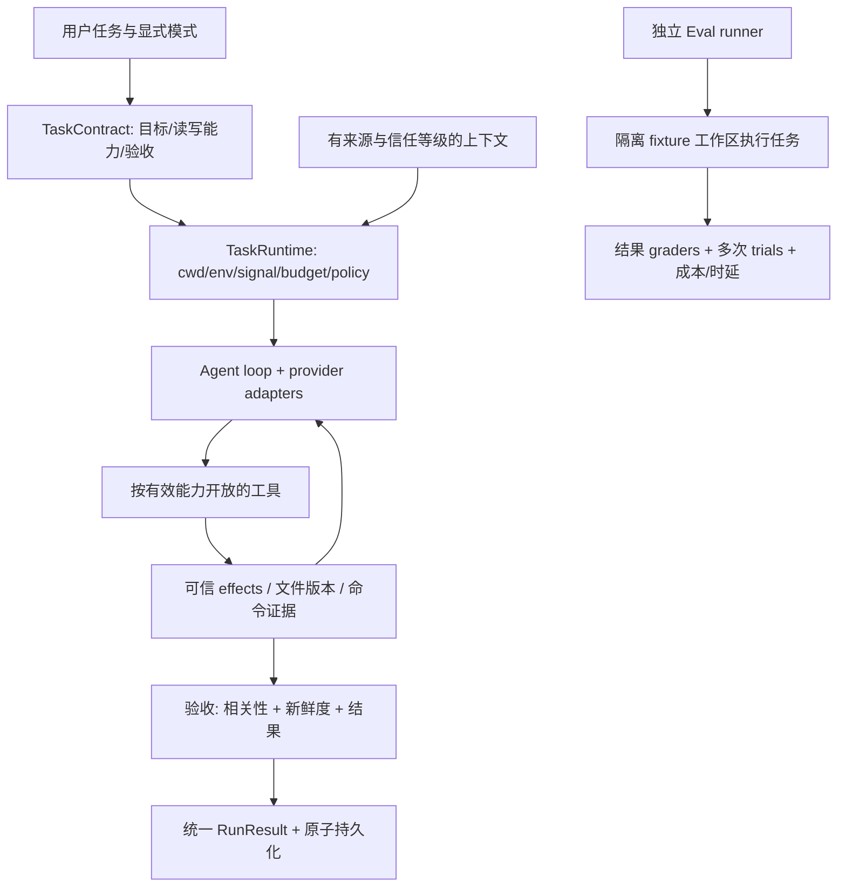

# Deecoo Harness 整体评估与改进路线

实施状态更新：本文保留实施前的证据和 open 状态作为历史快照；当前交付与自检结论见 [实施报告](harness-implementation-2026-10-21.md)。

评估日期：2026-10-21。评估对象为原 SCOR-001～010 修复后的工作树；这些原问题已完成修复，全量 253 项测试、语法检查、4 个 Eval 样例及 diff 格式检查通过。修复记录见 [原十项缺陷修复记录](/Users/adib/Documents/Deecoo/docs/review-fixes-2026-10-21.md)。

## 判断与适用范围

Deecoo 已具备本地 coding-agent harness 的基本形态：接收任务、构造上下文、调用模型、执行工具、返回反馈、控制资源并保存结果。目录划分总体有意义，直接调用 provider API 的方式也可以保留。

当前更适合“可信本地仓库、人在回路”的交互式工具。尚不能根据现有测试或 Eval 的 100 分，认定它具备可靠的自主编码验收、完整的中断恢复，或不可信项目的执行隔离。主要问题是执行证据、权限和跨 Worker 状态没有形成同一套可执行契约，而非缺少更多 Agent 角色。

本评估采用工程能力基准，不将某个 SDK 的接口或厂商文章当作认证标准：

- 任务和权限边界能否明确表达，并在真正的执行入口强制生效。
- 工具是否报告可验证的效果，父子 Agent 是否共享正确的工作区状态。
- 修改后是否有新鲜、相关且独立的验证证据。
- 中断、错误、预算、恢复和持久化能否保持一致。
- 能否复现完整执行，并以真实最终状态衡量质量、成本和时延。
- 增加的流程和抽象是否带来可测收益。

这组基准参考了 Agent harness 与 evaluation harness 的区别，以及“任务输入→多轮执行→真实环境结果→独立评分”的定义；运行记录与最终结果是不同对象。[Anthropic：Demystifying evals for AI agents](https://www.anthropic.com/research/demystifying-evals-for-ai-agents)

复杂度应随任务收益增加；简单、可组合的控制流也可以构成有效 harness，不必为了“像一个框架”强制多 Agent 或固定阶段。[Anthropic：Building effective agents](https://www.anthropic.com/research/building-effective-agents)

## 当前流程与目标流程

当前主流程可以概括为：CLI → 启发式分类/计划 → 上下文与任务准备 → Agent loop → provider/tool runtime → 结果格式校验 → audit/output/session。Eval 在另一条路径读取既存 trace/fixture 评分；它当前没有从 case.task 启动一次完整任务。

建议目标流程如下。这里描述的是后续设计，不代表当前已实现：

## 需要改进的具体契约

以下是第二阶段新增评估项，状态为 open、scope 为修复后工作树的既有设计。它们是后续改进建议，未混入原十项修复，也未在本次擅自重构。P1/P2 表示按实际影响和使用条件安排优先级；未实现的隔离/能力项会明确标为能力差距。

### HARNESS-001 — 验证通过状态没有绑定相关命令与当前代码版本

- severity: P1；status: open；lane: tests；scope: pre-existing（修复后快照）。
- issue_evidence: confirmed；定向离线复现成功。
- affected_files: [src/verification/state.js:34](/Users/adib/Documents/Deecoo/src/verification/state.js:34)、[src/verification/state.js:59](/Users/adib/Documents/Deecoo/src/verification/state.js:59)、[src/harness/finalValidation.js:4](/Users/adib/Documents/Deecoo/src/harness/finalValidation.js:4)、[src/harness/finalValidation.js:35](/Users/adib/Documents/Deecoo/src/harness/finalValidation.js:35)
- failure_scenario: 编辑文件后只运行 pwd，真实 runAgent + createToolRuntime 仍得到 workflow=completed、verification=passed。npm test 失败后 pwd 成功会成为 failed-then-passed；测试通过后再次修改也不使 passed 失效。最终 validator 不消费传入的 verification，明确写“npm test failed”的答案也可通过。
- impact: 完成状态可能给出错误保证；代码尚未验证、已经修改或测试仍失败时，用户和后续流程仍看到成功。
- reliable_solution: 将普通命令记录与 VerificationEvidence 分离；证据关联目标、命令及工作区修改版本。成功修改使相关证据失效，最终 gate 消费实际证据。区分 verified、unverified-with-reason、failed，允许有明确原因的无法运行，不把随便执行一条命令当验证。
- solution_fit: suited=yes；executable=yes；affordable=yes；cost=medium；verification=执行“失败测试→pwd”“通过测试→修改”“失败测试→终稿”必须保持失败或待验证；真正重跑相关测试才能恢复。
- verification_result: passed（确认现状/缺口，尚未验证建议实现）；定向离线复现成功。
- post_cor_candidate: yes，已有可定位根因和可执行验收；不表示本轮已实施。
- suggested_tests: 执行“失败测试→pwd”“通过测试→修改”“失败测试→终稿”必须保持失败或待验证；真正重跑相关测试才能恢复。

### HARNESS-002 — Eval 测量的是 trace 合规性，尚不能证明编码结果

- severity: P1；status: open；lane: tests；scope: pre-existing（修复后快照）。
- issue_evidence: confirmed；真实评分函数及当前 case/fixture 的合成变体复现。
- affected_files: [eval/runner.js:30](/Users/adib/Documents/Deecoo/eval/runner.js:30)、[eval/scoring.js:104](/Users/adib/Documents/Deecoo/eval/scoring.js:104)、[eval/scoring.js:117](/Users/adib/Documents/Deecoo/eval/scoring.js:117)、[eval/scoring.js:159](/Users/adib/Documents/Deecoo/eval/scoring.js:159)、[eval/cases/small-bugfix.json:13](/Users/adib/Documents/Deecoo/eval/cases/small-bugfix.json:13)
- failure_scenario: runner 读取已有 fixture/audit，未执行 case.task，也未建立工作区或独立检查文件内容。small-bugfix 把验证命令替换成 pwd 仍为 100 分；合法 edit_file 换成 apply_patch 反而失败。case 文本经实际分类器为 debug，但期望硬写 edit。这里约束的是工具集合，未要求工具顺序。
- impact: 手工样例的满分不能衡量真实模型+harness 的完成能力，也可能奖励只满足报告字段的运行、拒绝另一种合法实现。
- reliable_solution: 保留当前代码作为 grader 单元测试/trace lint。新增独立 Eval runner：隔离工作区执行任务、用外部测试及最终 diff/状态评分。精确工具和分类标签用于分支测试；能力评估允许等价工具路径，权限禁止行为仍作硬 gate。分别报告 harness 回归、grader 正确性、模型能力。
- solution_fit: suited=yes；executable=yes；affordable=yes；cost=medium/high；verification=同任务用 edit_file、apply_patch、Worker 实现均可成功；未修复真实测试即失败；固定模型/配置做多次 trials 并记录成功率、用量、时延。
- verification_result: passed（确认现状/缺口，尚未验证建议实现）；真实评分函数及当前 case/fixture 的合成变体复现。
- post_cor_candidate: yes，已有可定位根因和可执行验收；不表示本轮已实施。
- suggested_tests: 同任务用 edit_file、apply_patch、Worker 实现均可成功；未修复真实测试即失败；固定模型/配置做多次 trials 并记录成功率、用量、时延。

### HARNESS-003 — Worker 的真实副作用没有归集到父状态和缓存

- severity: P1；status: open；lane: code；scope: pre-existing（修复后快照）。
- issue_evidence: confirmed；真实父/子 runtime 与临时文件复现；provider 为模拟。
- affected_files: [src/agent/subagents/runtime.js:140](/Users/adib/Documents/Deecoo/src/agent/subagents/runtime.js:140)、[src/agent/state.js:125](/Users/adib/Documents/Deecoo/src/agent/state.js:125)、[src/agent/state.js:142](/Users/adib/Documents/Deecoo/src/agent/state.js:142)、[src/harness/processController.js:246](/Users/adib/Documents/Deecoo/src/harness/processController.js:246)、[src/agent/loop.js:320](/Users/adib/Documents/Deecoo/src/agent/loop.js:320)
- failure_scenario: 父先读 OLD，Worker 实际写成 NEW 并执行 printf synthetic。文件已为 NEW，但父 filesEdited/commandsRun 仍为空、verification=not-run；父再读被 ALREADY_AVAILABLE 短路并返回 OLD。Worker 的 usage 已在原 SCOR-003 修复，本项是其他运行时效果的独立缺口。
- impact: 委派修改的完成验收、后续决策和缓存内容可能失真；全由 Worker 完成修改时，父可能仍判断没有编辑。
- reliable_solution: Worker 返回由 runtime 产生的可信 effects/events：edited paths、commands、verification、文件版本和事件 ID。父统一归集并按路径使观察缓存失效。不要把 Worker 正文自报的 filesTouched 当作可信事实。
- solution_fit: suited=yes；executable=yes；affordable=yes；cost=medium；verification=父读→子写→父重读必须看到 NEW；Worker 独立 edit/verify 后，父验收与最终报告准确；事件重复投递不重复计数。
- verification_result: passed（确认现状/缺口，尚未验证建议实现）；真实父/子 runtime 与临时文件复现；provider 为模拟。
- post_cor_candidate: yes，已有可定位根因和可执行验收；不表示本轮已实施。
- suggested_tests: 父读→子写→父重读必须看到 NEW；Worker 独立 edit/verify 后，父验收与最终报告准确；事件重复投递不重复计数。

### HARNESS-004 — 实现 Worker 缺少可执行的写入所有权与互斥

- severity: P1；status: open；lane: code；scope: pre-existing（修复后快照）。
- issue_evidence: confirmed；真实主/子编排、模拟模型复现同时启动；未实际制造文件损坏。
- affected_files: [src/agent/loop.js:307](/Users/adib/Documents/Deecoo/src/agent/loop.js:307)、[src/agent/loop.js:531](/Users/adib/Documents/Deecoo/src/agent/loop.js:531)、[src/tools/definitions.js:298](/Users/adib/Documents/Deecoo/src/tools/definitions.js:298)
- failure_scenario: isParallelDispatch 不区分 mode，两个 implement Worker 可同时启动；合成用例指向同一 shared.txt，最大并发数为 2。所有 Worker 共享 cwd，schema 没有 writeScope。注释所称工作区隔离并未通过独立 checkout 实现。
- impact: 发生重叠写入时可能互相覆盖或使补丁/验证依据过期。启用预算后的模型请求串行不能代替文件写入互斥。
- reliable_solution: 最小方案是未知写集合的 implement 任务串行。后续提供规范化 writeScope、路径锁和冲突检测，不相交作用域可并行；需要更强隔离时采用独立 worktree 与受控合并。
- solution_fit: suited=yes；executable=yes；affordable=yes；cost=low/medium；独立 worktree 为 high；verification=同文件任务不能重叠提交；不相交 scope 可并行；research 保持并发；取消不会释放尚在提交中的写锁。
- verification_result: passed（确认现状/缺口，尚未验证建议实现）；真实主/子编排、模拟模型复现同时启动；未实际制造文件损坏。
- post_cor_candidate: yes，已有可定位根因和可执行验收；不表示本轮已实施。
- suggested_tests: 同文件任务不能重叠提交；不相交 scope 可并行；research 保持并发；取消不会释放尚在提交中的写锁。

### HARNESS-005 — 任务只读、Worker profile 与文件模式没有统一执行策略

- severity: P1；status: open；lane: code；scope: pre-existing（修复后快照）。
- issue_evidence: confirmed；源码控制路径确定；未测试模型是否会主动违规。
- affected_files: [src/agent/taskRunner.js:95](/Users/adib/Documents/Deecoo/src/agent/taskRunner.js:95)、[src/tools/runtime.js:57](/Users/adib/Documents/Deecoo/src/tools/runtime.js:57)、[src/tools/definitions.js:1](/Users/adib/Documents/Deecoo/src/tools/definitions.js:1)、[src/tools/shell.js:33](/Users/adib/Documents/Deecoo/src/tools/shell.js:33)、[src/skills/scor.js:5](/Users/adib/Documents/Deecoo/src/skills/scor.js:5)
- failure_scenario: taskSpec 对普通 review 声明 reviewOnly，但只有同时加载 S-COR 才设置阻止直接写工具的 policy。verify 没有直接编辑工具，却有完整 run_shell；Shell 不读取文件 permissionMode。npm test 和未知 local-project-check 都分类为 allow。
- impact: 任务合同的“不可写”描述强于实际边界；verify 命令可具有仓库脚本副作用。README 将 read-only 明确称为文件编辑权限，这部分命名有文档解释，不能将它误说成已承诺 OS 只读隔离。
- reliable_solution: 有效能力应为用户授权 ∩ TaskContract ∩ Worker profile ∩ 环境策略，schema 与 execute 共用同一计算结果。review 策略不依赖技能名称；S-COR 只提供报告适配。verify 要么在隔离副本执行命令，要么明确标注其允许命令副作用的语义。
- solution_fit: suited=yes；executable=yes；affordable=yes；cost=medium；verification=普通 review 即使用户启用 workspace-write 也不开放写工具；research 无 Shell；verify 无法修改原工作区，合法测试可在隔离副本运行。
- verification_result: passed（确认现状/缺口，尚未验证建议实现）；源码控制路径确定；未测试模型是否会主动违规。
- post_cor_candidate: yes，已有可定位根因和可执行验收；不表示本轮已实施。
- suggested_tests: 普通 review 即使用户启用 workspace-write 也不开放写工具；research 无 Shell；verify 无法修改原工作区，合法测试可在隔离副本运行。

### HARNESS-006 — 永久授权的命令键不精确，默认也未绑定项目

- severity: P2；status: open；lane: code；scope: pre-existing（修复后快照）。
- issue_evidence: confirmed；仅计算合成命令批准键，没有执行命令。
- affected_files: [src/permissions/shellPolicy.js:85](/Users/adib/Documents/Deecoo/src/permissions/shellPolicy.js:85)、[src/config/settings.js:96](/Users/adib/Documents/Deecoo/src/config/settings.js:96)、[src/cli.js:77](/Users/adib/Documents/Deecoo/src/cli.js:77)
- failure_scenario: normalizeShellCommand 折叠整个命令中的空白，包括引号内部。cp 'a  b.txt' result.txt 与 cp 'a b.txt' result.txt 得到同一批准键。默认批准存在全局 settings，同一字符串换 cwd 仍自动复用；不同 --settings 可手动隔离，但不是默认项目授权。
- impact: 一次授权可能匹配到语义不同的文件参数，或在另一项目中运行另一份同名脚本。
- reliable_solution: 命令键最小只 trim 外部空白，不尝试不完整的 Shell 等价归一化。授权记录包含 canonical workspace、精确命令、策略版本及范围；默认项目级，全局授权作为明确独立选项。
- solution_fit: suited=yes；executable=yes；affordable=yes；cost=low/medium；verification=引号内空格不同不共享授权；A 项目授权不用于 B；原项目原命令仍能复用；block 级永远高于 standing approval。
- verification_result: passed（确认现状/缺口，尚未验证建议实现）；仅计算合成命令批准键，没有执行命令。
- post_cor_candidate: yes，已有可定位根因和可执行验收；不表示本轮已实施。
- suggested_tests: 引号内空格不同不共享授权；A 项目授权不用于 B；原项目原命令仍能复用；block 级永远高于 standing approval。

### HARNESS-007 — 敏感路径规则在文件、搜索与 Shell 间不一致

- severity: P2；status: open；lane: code；scope: pre-existing（修复后快照）。
- issue_evidence: confirmed；只调用路径分类器，未读取真实凭据。
- affected_files: [src/tools/pathPolicy.js:13](/Users/adib/Documents/Deecoo/src/tools/pathPolicy.js:13)、[src/tools/pathPolicy.js:91](/Users/adib/Documents/Deecoo/src/tools/pathPolicy.js:91)、[src/permissions/shellPolicy.js:16](/Users/adib/Documents/Deecoo/src/permissions/shellPolicy.js:16)、[src/tools/search.js:30](/Users/adib/Documents/Deecoo/src/tools/search.js:30)
- failure_scenario: 文件路径规则主要是少数 basename。合成工作区内 .env.staging、.aws/credentials、.ssh/config、.npmrc 会被 assertSafePath 接受；Shell 对这些路径有更广规则，search 又单独排除 .env*。
- impact: 不会越过已实现的 workspace/realpath 边界；但凭据若位于允许工作区内，research 文件工具的保护与说明不一致。
- reliable_solution: 建立统一 SensitivePathPolicy，覆盖 list/read/search/write，明确 .env.example 等样例例外。子进程真正访问哪些路径应由执行隔离限制，不能仅靠 Shell 文本匹配证明。
- solution_fit: suited=yes；executable=yes；affordable=yes；cost=medium；verification=合成敏感目录/文件变体在各工具一致拒绝；普通源码和脱敏样例仍可访问；符号链接边界继续通过现有回归。
- verification_result: passed（确认现状/缺口，尚未验证建议实现）；只调用路径分类器，未读取真实凭据。
- post_cor_candidate: yes，已有可定位根因和可执行验收；不表示本轮已实施。
- suggested_tests: 合成敏感目录/文件变体在各工具一致拒绝；普通源码和脱敏样例仍可访问；符号链接边界继续通过现有回归。

### HARNESS-008 — 初始上下文、Memory 与工具结果缺少统一信任等级

- severity: P2；status: open；lane: code；scope: pre-existing（修复后快照）。
- issue_evidence: confirmed；数据入口的 role 和字段处理由代码确认；未验证注入成功。
- affected_files: [src/context/workspaceSnapshot.js:42](/Users/adib/Documents/Deecoo/src/context/workspaceSnapshot.js:42)、[src/context/workspaceSnapshot.js:173](/Users/adib/Documents/Deecoo/src/context/workspaceSnapshot.js:173)、[src/memory/projectMemory.js:41](/Users/adib/Documents/Deecoo/src/memory/projectMemory.js:41)、[src/memory/projectMemory.js:214](/Users/adib/Documents/Deecoo/src/memory/projectMemory.js:214)、[src/harness/contentTrust.js:60](/Users/adib/Documents/Deecoo/src/harness/contentTrust.js:60)
- failure_scenario: README/package snapshot 直接作为 system 消息；没有规则文件时 README 还成为 primary instructions。memory 提升为 system 时未展示 source/confidence/expiresAt 等 provenance。工具隔离仅处理部分字符串，search.matches 数组不在名单。
- impact: 普通仓库内容和模型推导记忆被赋予与明确规则相近的权威；同一文本经不同入口处理不一致。这里报告的是信任边界差异，不声称已经复现凭据泄露或提示注入攻击。
- reliable_solution: 统一 ContextEnvelope：来源、信任等级、作用域、有效期和引用。明确受信的项目规则保留指令身份；README、搜索、观察及推导记忆保持数据身份。文本叶子递归处理，并在摘要和跨 Worker 传递中保留来源。
- solution_fit: suited=yes；executable=yes；affordable=yes；cost=medium；verification=同一合成指令样文本从 read/search/README/memory 进入都保持数据身份；明确受信项目规则仍按用户选择的优先级生效。
- verification_result: passed（确认现状/缺口，尚未验证建议实现）；数据入口的 role 和字段处理由代码确认；未验证注入成功。
- post_cor_candidate: yes，已有可定位根因和可执行验收；不表示本轮已实施。
- suggested_tests: 同一合成指令样文本从 read/search/README/memory 进入都保持数据身份；明确受信项目规则仍按用户选择的优先级生效。

### HARNESS-009 — checkpoint 写入、清理与 CLI 恢复没有形成闭环

- severity: P2；status: open；lane: code；scope: pre-existing（修复后快照）。
- issue_evidence: confirmed；真实 runTask/store；仅人为延迟写入 100ms，临时目录复现。
- affected_files: [src/agent/taskRunner.js:157](/Users/adib/Documents/Deecoo/src/agent/taskRunner.js:157)、[src/agent/taskRunner.js:245](/Users/adib/Documents/Deecoo/src/agent/taskRunner.js:245)、[src/agent/taskRunner.js:299](/Users/adib/Documents/Deecoo/src/agent/taskRunner.js:299)、[src/commands/dispatcher.js:22](/Users/adib/Documents/Deecoo/src/commands/dispatcher.js:22)、[src/commands/actions.js:53](/Users/adib/Documents/Deecoo/src/commands/actions.js:53)
- failure_scenario: loadCheckpoint 在 src 中只有定义，CLI resume 只恢复聊天，runTask 未给 runAgent 传 resume。void persistCheckpoint 与 clearCheckpoint 无顺序约束；延迟写入时任务 completed 后 checkpoint 文件重新出现。
- impact: 用户入口尚不能继续中断执行；成功后的残留 checkpoint 会与实际状态冲突。底层序列化和 resume 能力并非冗余，问题是尚未接成完整产品流程。
- reliable_solution: 任务持有 checkpoint 写队列，结束时先 flush/取消旧写再清理；写入带 run ID/版本并原子替换。区分恢复聊天与继续中断运行；恢复前校验工作区、模型、权限和副作用记录，避免重复执行。
- solution_fit: suited=yes；executable=yes；affordable=yes；cost=medium；verification=成功后 checkpoint 不重现；CLI 继续中断任务恢复同一 step/messages/usage；工作区漂移被明确拒绝或重新规划。
- verification_result: passed（确认现状/缺口，尚未验证建议实现）；真实 runTask/store；仅人为延迟写入 100ms，临时目录复现。
- post_cor_candidate: yes，已有可定位根因和可执行验收；不表示本轮已实施。
- suggested_tests: 成功后 checkpoint 不重现；CLI 继续中断任务恢复同一 step/messages/usage；工作区漂移被明确拒绝或重新规划。

### HARNESS-010 — 自然语言分类与完成校验会误解否定或混合任务

- severity: P2；status: open；lane: code；scope: pre-existing（修复后快照）。
- issue_evidence: confirmed；分类器、taskSpec 和最终校验器的纯函数复现。
- affected_files: [src/agent/coordination.js:33](/Users/adib/Documents/Deecoo/src/agent/coordination.js:33)、[src/agent/coordination.js:74](/Users/adib/Documents/Deecoo/src/agent/coordination.js:74)、[src/harness/taskSpec.js:10](/Users/adib/Documents/Deecoo/src/harness/taskSpec.js:10)、[src/harness/finalValidation.js:63](/Users/adib/Documents/Deecoo/src/harness/finalValidation.js:63)
- failure_scenario: “审查错误处理，不要修改”被分成 debug，reviewOnly=false；完成 validator 因“不要修改”包含“修改”，要求有成功编辑。虽然派生 spec 提示以用户原意为准，硬 gate 仍拒绝遵守只读要求的答案。
- impact: 守约的审查可能被错误拒绝，触发额外修复循环；类型、读写授权和完成条件混为一组关键词。
- reliable_solution: 显式 TaskContract 分离 intent、mayWrite、phases、acceptance；显式否定和用户模式优先。启发式只做路由建议，不独立决定授权或强制修改；多阶段请求保留阶段边界。减少以终稿关键词代替事实验收。
- solution_fit: suited=yes；executable=yes；affordable=yes；cost=medium；verification=中文/英文否定、仅分析错误、先修后评、多阶段任务均有正确读写能力；遵守只读的有效答案不被要求编辑。
- verification_result: passed（确认现状/缺口，尚未验证建议实现）；分类器、taskSpec 和最终校验器的纯函数复现。
- post_cor_candidate: yes，已有可定位根因和可执行验收；不表示本轮已实施。
- suggested_tests: 中文/英文否定、仅分析错误、先修后评、多阶段任务均有正确读写能力；遵守只读的有效答案不被要求编辑。

### HARNESS-011 — Review 完成 gate 只验证格式，未检查目标证据

- severity: P2；status: open；lane: tests；scope: pre-existing（修复后快照）。
- issue_evidence: confirmed；真实 runTask+工具 runtime 复现，无 provider 网络。
- affected_files: [src/reporter/reviewReport.js:39](/Users/adib/Documents/Deecoo/src/reporter/reviewReport.js:39)、[src/reporter/reviewReport.js:81](/Users/adib/Documents/Deecoo/src/reporter/reviewReport.js:81)、[src/agent/taskRunner.js:160](/Users/adib/Documents/Deecoo/src/agent/taskRunner.js:160)
- failure_scenario: 临时源码有独立 SOURCE_SENTINEL；初始 snapshot 只传文件名，没有传源码。模型零工具调用便返回 schema-valid findings=[]，任务仍 completed；filesRead 和 trace 均为空，sentinel 未进入模型请求。
- impact: “无发现”无法区分已检查且无问题、根本没有看到目标代码。输出 JSON 合法不等于审查有覆盖。
- reliable_solution: 报告加入可追溯 coverage：revision、输入代码/已读文件、未覆盖范围和证据引用；完成 gate 检查证据来源。不要简单强制 read_file，因为用户也可能在 prompt 内提供全部目标代码。
- solution_fit: suited=yes；executable=yes；affordable=yes；cost=medium；verification=无目标证据不能标记完整审查；允许内联代码审查；部分覆盖明确显示 partial 与未覆盖范围。
- verification_result: passed（确认现状/缺口，尚未验证建议实现）；真实 runTask+工具 runtime 复现，无 provider 网络。
- post_cor_candidate: yes，已有可定位根因和可执行验收；不表示本轮已实施。
- suggested_tests: 无目标证据不能标记完整审查；允许内联代码审查；部分覆盖明确显示 partial 与未覆盖范围。

## 每个部分应保留、合并还是简化

1. **Provider adapters 与 Agent loop：保留。** 供应商协议差异应留在 adapter，loop 消费统一完成状态、错误、usage 和工具调用。后续补 provider contract tests；不为“符合标准”更换整个 SDK。未验证真实服务能力，离线通过不能替代线上协议兼容验证。

2. **edit/debug/review：保留能力，减少标签驱动的硬流程。** 编辑、诊断、审查的验收不同，分层合理；统一 TaskContract，避免 coordination、taskSpec、finalValidation 重复猜测同一读写意图。简单任务由一个 Agent 完成，复杂任务再委派。

3. **verification 与 Eval：均保留，明确两种职责。** verification 是本次执行中的反馈和验收证据；Eval 是独立衡量系统表现。当前 trace 评分器也可保留，但应命名为 grader/trace lint，不能替代端到端 Eval runner。

4. **文件工具：保留安全复核，不因重复读取就删除。** propose 与 apply 的预览/写入职责不同；授权后的重新读文件、期望内容/hash 检查和 patch set 回滚有实际价值，属于防竞态检查。可让一次规划对象复用，但写前必须重验证。

5. **权限：合并政策来源，执行器仍分开。** 文件路径能力、Shell 执行、网络访问是不同权限。统一有效 capability 与敏感路径规则；不要把完整 Shell 语义硬塞进更多正则，或认为一份工具名白名单就是沙箱。

6. **Worker：保留，先补 effects 与 writeScope。** research、verify、implement 比不断增加角色名称更重要。角色是提示词，mode/capability 才是执行权限。独立验证有收益，但不是每个小编辑都必须创建新 Worker。

7. **workflow/transitions/AgentState/tracer：保留不同投影，合并事件来源。** 状态机、给模型的运行摘要、审计指标用途不同，不应全部删除；同一工具事件目前由多处手工维护。建议一个带 taskId/workerId 的运行时事件入口，用纯 reducer 派生投影，不必引入大型事件框架。

8. **processController 与 read cache：保留不同用途，共享版本失效规则。** 前者负责工具去重、工作集和防空转，并非 OS 子进程控制器，宜重命名为 ToolProgressGuard 或拆清职责。缓存按文件版本/修改序号失效，避免 Worker 修改后父重复使用旧观察。防空转阈值也应按 review/analysis/edit 区分。

9. **Context/index/snapshot：有确定的冗余采集，可简化。** taskRunner 先 buildProjectIndex，buildProjectIndexMessages 又重复遍历；启动 ensure、任务 snapshot、结束刷新也重复读 README/目录/Git。拆开采集与格式化，同次准备复用，修改后失效；先测 prepare_ms、扫描次数和 p50/p95，不预报加速百分比。

10. **Session/project/global memory 与 artifacts：保留作用域，收紧写入与来源。** 会话历史、项目事实、跨项目偏好、技能交接产物用途不同；不要机械合并成一个巨型 memory。使用 provenance、TTL 和用户确认过的长期事实，给每层分配预算并避免重复注入。滚动摘要已修复，但规则提取不能保证记住所有隐含约束。

11. **模型/工具 record-replay：保留两侧接口，共用消费规则。** 本轮已将重复调用消费抽到 createReplayEntries。下一步将 requestFingerprint 纳入 tools、tool_calls 和关键采样参数，并保存 provider/model/配置版本，明确旧 fixture 迁移策略；当前 strict 的消费语义正确不代表 fingerprint 已覆盖所有语义差异。

12. **CLI 与 reporter：作为适配层保留。** CLI 不应拥有核心任务状态；用统一 RunResult 展示与导出。S-COR 等特定技能的报告 schema/metadata 可下沉成 adapter，通用 review 权限不要依赖技能名称。避免在核心 loop 写死更多业务格式。

13. **环境与进程隔离：按目标补能力。** 当前 withIsolatedEnv 通过全局 mutex 临时修改 process.env，只是序列化的进程内兼容办法，不是真正任务隔离。后续通过显式 TaskRuntimeContext 传 cwd/env，Shell 子进程单独获得过滤后的 env；长命令需要真正的进程组生命周期管理。

## 权限默认值是否合理

适合保留的做法：ask-once 每任务重置；--yes 与文件写授权分开；Worker 工具集合受限；block 级高于自动/永久批准；文件真实路径校验、写前复核、secret registry 和新加入的取消链均有价值。

需要调整的默认：普通 review 也应有硬性任务策略；永久授权默认项目级并保留命令字节语义；verify 的原工作区不可写承诺应有隔离实现；allow 应表示经过已定义策略允许，而不是“没有匹配到已知危险模式”。

当前 child_process.exec 只有 cwd、环境过滤、超时和 signal，没有 OS 文件/网络隔离。README 已说明这不是完整沙箱，因此本项是产品定位与能力差距。若目标包含不可信仓库或无人值守执行，需为子进程及其后代实施文件系统和网络边界；仅 egress 命令字符串提取不能覆盖脚本和第三方程序的真实访问。[Anthropic：Beyond permission prompts](https://www.anthropic.com/research/claude-code-sandboxing)

## 建议实施顺序

**第一批：完成证据闭环。** HARNESS-001、003、005 优先，连同 Worker 写入互斥的最小方案。目标是“执行结果可信、验收可信、任务权限不可因委派改变”。这些工作比增加新 Agent 角色或提示词更优先。

**第二批：把 Eval 变成可验证结果的测量系统。** 分离 grader 单测和端到端 runner；先用隔离 fixture 与 deterministic replay 覆盖 edit/review/command/permission/recovery，再在固定模型、固定配置下重复真实 trials。记录 outcome、禁止副作用、验证新鲜度、成功率、tokens/cost、p50/p95 时延和人工介入次数；精确工具集合只用于测试特定分支。

**第三批：恢复和权限生命周期。** 项目级批准、统一敏感路径、checkpoint 写队列/原子替换、CLI 的继续中断执行、上下文来源等级。若计划无人值守使用，把 OS 执行隔离提前到第一批。

**第四批：做减法和性能优化。** 复用索引/snapshot、合并重复意图规则、用单一事件流派生状态、按任务模式减少不必要 Worker/提示词和历史注入。以相同 fixture 的成功率不降、准备延迟/上下文量降低为验收；不以删文件数量评价优化。

长任务要靠明确的进度和可恢复工件交接，而不只是扩大摘要或重复发送历史；这是恢复设计值得保留并补齐的原因。[Anthropic：Effective harnesses for long-running agents](https://www.anthropic.com/research/effective-harnesses-for-long-running-agents)

## 快照、验证与范围限制

- 原修复基线 HEAD：50e809d8a286662d42e8d462b2c9772d9f2dd30d；评估对象为其上的未提交修复工作树，非只读 HEAD。
- Node v24.21.0；项目声明 Node >=20。未安装新运行依赖。
- 最终代码检查：253/253 Node 测试通过；npm run check 通过；4/4 Eval fixtures 通过；git diff --check 通过。
- 新评估通过源码调用路径、纯函数检查、临时工作区和模拟 provider 复现；没有真实模型请求、没有读真实凭据或制造真实文件损坏。
- 全部 src 模块按关键路径抽查；不是穷尽安全审计。真实 provider、真人 TTY、断电/崩溃耐久性、所有 Node 版本及大型仓库性能尚未实际测量。
- Eval 满分只说明当前 grader 对固定记录的判断，不代表上面建议已完成或能力基准已通过。

离线评估附件（断言现有设计缺口，独立于通过的产品回归测试）：

- [执行/验证/Eval 复现](/Users/adib/.codex/visualizations/2026/10/21/01a15dd6-fcdb-7831-a5ca-90f9cb9dfec3/deecoo-review/repro-harness-eval.mjs)。
- [Worker 状态/并发/checkpoint 复现](/Users/adib/.codex/visualizations/2026/10/21/01a15dd6-fcdb-7831-a5ca-90f9cb9dfec3/deecoo-review/repro-harness-state.mjs)。

源码快照指纹（排序后的 src/ 路径与内容 SHA-256）：65decd3cf3196c5e28c31c0e8ac0814759c16f49f28454726307cd591d5e30f6。
